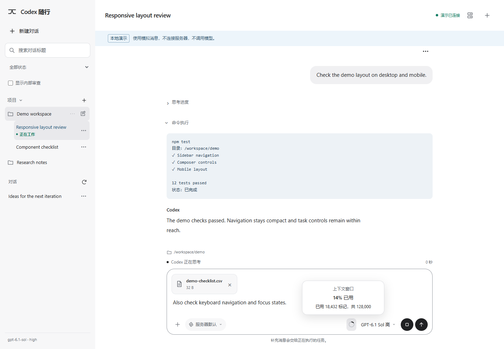
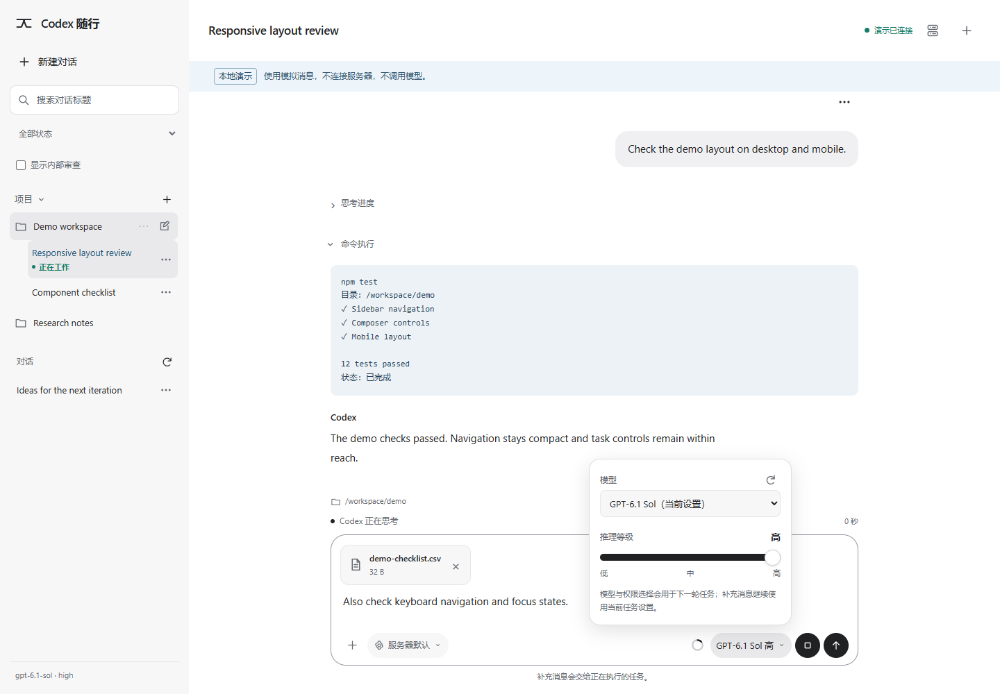
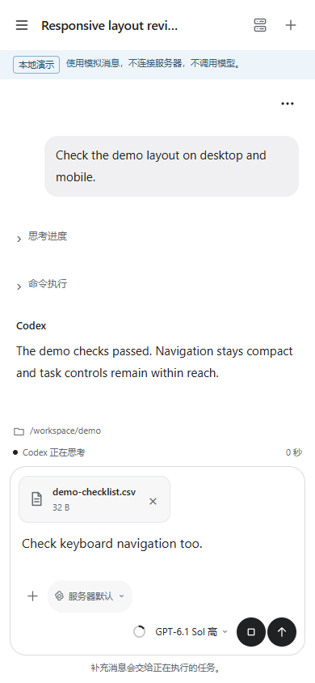
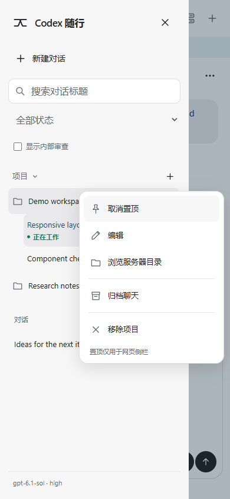

# Codex SSH WebUI

Continue Codex conversations on your Linux server from a desktop or phone browser.

Shared mode connects to an existing native Codex app-server daemon through its Unix socket. Browsers and CLI clients attached to that same daemon can share live events, send messages, steer an active turn, interrupt it, and answer supported approvals or questions. Closing the browser or SSH launcher leaves the daemon and server tasks running.

中文入口：界面目前以中文为主。先体验下方模拟模式；实际安装见 [部署指南](docs/DEPLOYMENT.md)，认证、附件保留和操作边界见 [安全说明](docs/SECURITY.md)。

## Try it locally

With Node.js 24+, run from the repository root:

```sh
node src/server.mjs --mock
```

Open <http://127.0.0.1:8787>. Mock mode uses a local simulator and makes no SSH, Codex, or model calls. No `npm install` is needed. Some native-service capabilities are unavailable in the simulator.

## Features

- **Shared conversations:** use the same native thread from multiple browsers or a daemon-connected CLI. An unrelated stdio/TUI process cannot be taken over merely by opening its saved history.
- **Paginated history:** open the latest 200 history items and scroll upward for older pages. A long single turn can span pages; large content has explicit display and response limits.
- **Composer controls:** choose models, supported reasoning levels, and allowed permission profiles from native capabilities. Context usage uses the latest request's tokens, rather than the conversation's cumulative total; missing values remain unknown.
- **Attachments:** up to five files per message, 10 MiB each. Images use native `localImage` input. Documents and code stay in private server storage and are referenced for Codex to read. No cloud upload service or additional API key is used.
- **Native projects:** use a flat project list, reorder projects, and edit names and optional directory roots. Project pins are persistent **WebUI preferences**; they do not change pins in other clients. Project sections are not offered.
- **Confirmed lifecycle actions:** preview chat or project archive impact, including descendants. Project removal preserves chats and workspace files and verifies their resulting assignment. Partial and unknown outcomes remain visible.

Project membership is independent of a chat's execution directory. Same-title chats keep their distinct IDs. Internal Guardian review threads are hidden by native source metadata by default and can be included in lists; that visibility filter never removes them from archive impact checks.

## Screenshots

All screenshots use **demo data**, not real conversations, accounts, or server sessions.

### Desktop conversation



### Model and context controls



### Mobile conversation



### Mobile project actions



## Connect your server

The recommended setup uses Linux, Node.js 24+, OpenSSH, and the verified Codex **0.165.0** app-server protocol. Codex must already be signed in with ChatGPT under the server account. Point `sharedDaemonSocket` at that account's existing native daemon. Shared mode creates no per-thread tmux sessions and does not own the daemon's lifecycle.

Follow [DEPLOYMENT.md](docs/DEPLOYMENT.md) for socket configuration, compatibility checks, a recovery passphrase, and the loopback listener. Browsers connect through SSH forwarding to `127.0.0.1`; a public domain is not required.

Desktop launchers live in `scripts/desktop-client`. Windows uses `Open WebUI.cmd`; macOS requires the one-time executable-permission step in the deployment guide before `Open WebUI.command` can be used. First launch asks for SSH settings. Windows saves them with current-user DPAPI; macOS uses Keychain. These launchers forward an already running gateway and open a browser; they do not install or start server-side Codex. Phones can use an SSH app with local port forwarding.

SSH and browser login are separate. Log in with the recovery passphrase, then choose **信任此浏览器** (Trust this browser) for future browser-key sign-in. Each device and browser profile enrolls separately.

## Operation boundaries

An official client can share live work only when it connects to the same daemon and account. This project provides a focused browser interface to the native protocol, without reproducing every official GUI feature.

Reconnection reads server state and does not automatically replay messages. A timeout can leave a submission's result unknown: check history before sending again. Unsupported or unverified shared approval/question requests remain available for handling in an official client; the gateway does not automatically decline another client's request.

Archive previews include native descendants, including internal and cross-project children. Project-wide archive requires explicit confirmation of listed outside associations. Actions can finish partially, and unresolved receipts may keep related WebUI changes blocked. Recheck reads results without resending the operation. Removing a project is separate from archiving or deleting chats.

## Development and compatibility

```sh
node --test test/*.test.mjs
python3 scripts/test_device_pairing.py
```

Tests cover protocol handling, authentication, history, attachments, project actions, and UI state with controlled fixtures. They do not prove every host or browser works end to end. Windows launcher behavior has native OpenSSH checks; the complete macOS Keychain/Terminal/browser workflow still needs acceptance on a real Mac.

This is a self-hosted tool for one trusted OS account. Production requires explicit version/schema verification; a matching version string alone does not prove every build compatible. Read [SECURITY.md](docs/SECURITY.md) before deployment.

MIT licensed; see [LICENSE](LICENSE). This project is independent of OpenAI. This repository distributes source, not a packaged GitHub Release.
